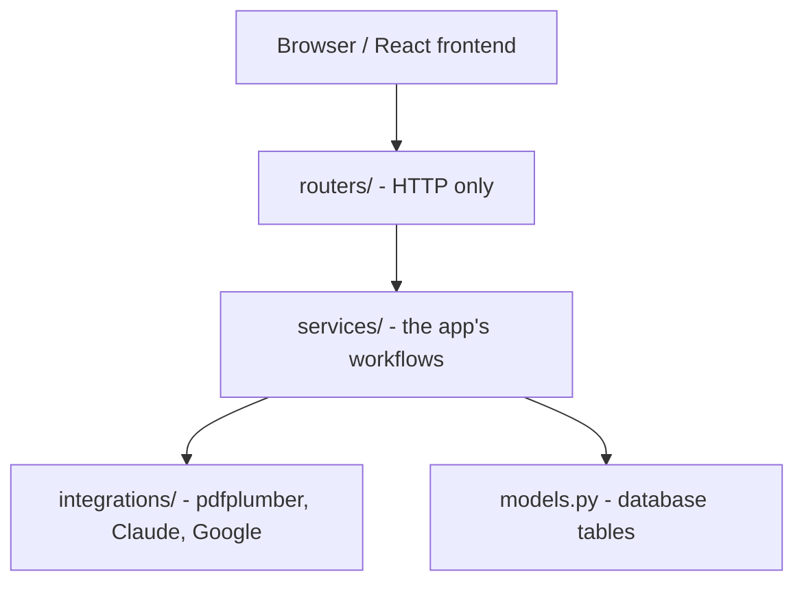
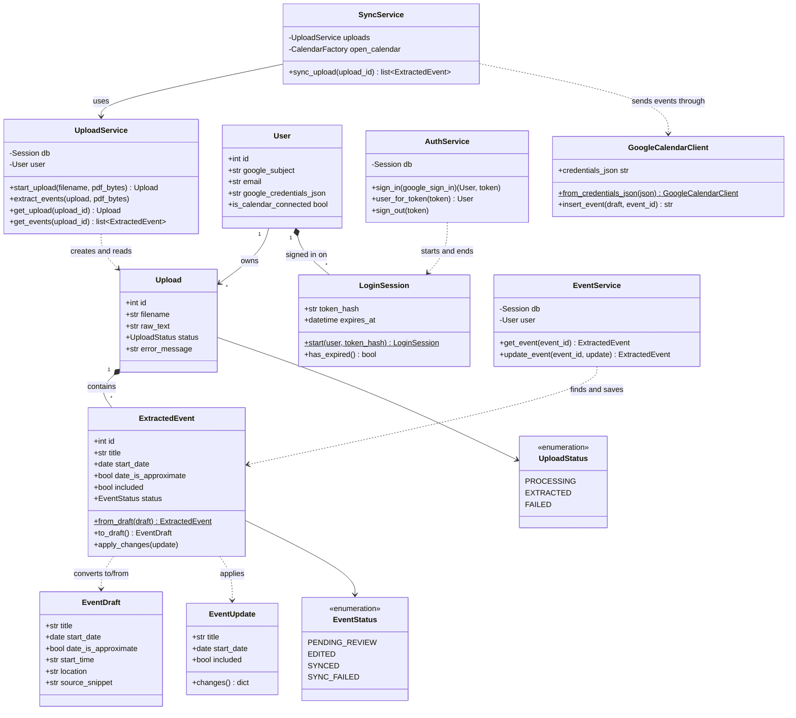
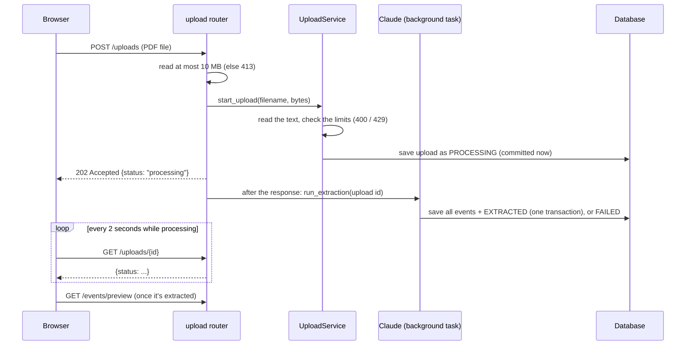
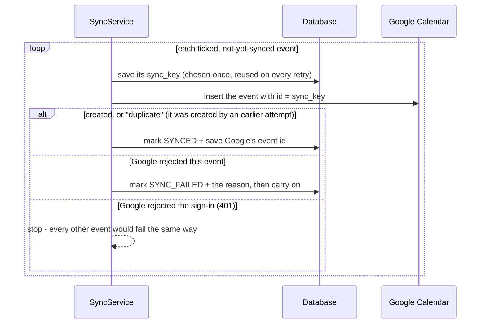
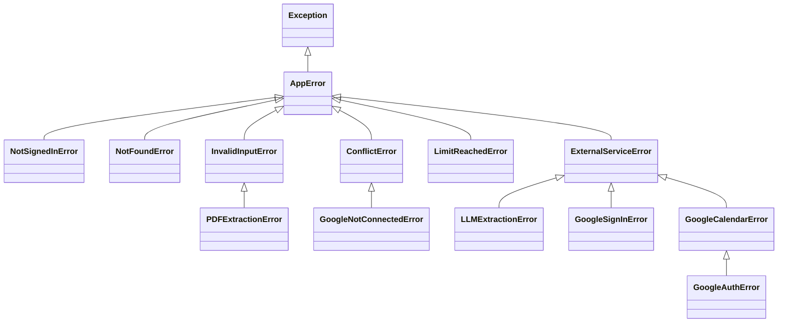
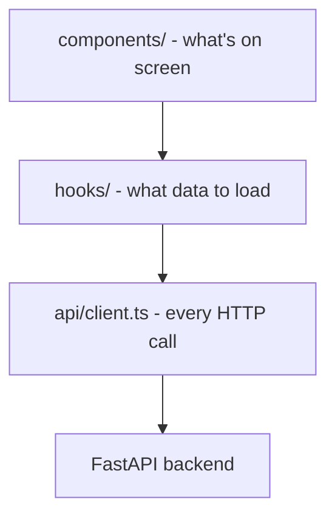
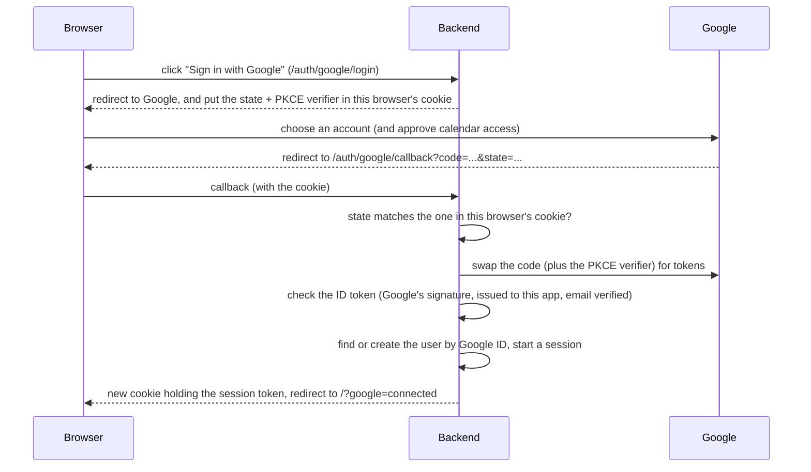

# Architecture

This document explains how Syllabus2Cal is put together and why I made the design
choices I did.

## What the app does

You sign in with Google, then upload a course schedule or syllabus PDF. The backend pulls the text and tables out of
it, asks Claude to turn them into structured calendar events, and saves them. You review the
events (fix dates, untick ones you don't want), then sync the rest to Google Calendar.

The review step is the core idea. An LLM will sometimes misread a table or guess a date, so
nothing reaches your real calendar until a person has looked at it.

## The big picture: layers

The backend is split into layers, and each layer only talks to the ones below it.



| Layer | Job | Example |
|---|---|---|
| `routers/` | Read the HTTP request, call a service, return a response | `POST /uploads` reads the file and enforces the 10 MB limit |
| `services/` | The app's own rules and workflows | `UploadService.start_upload()` - check limits, save, hand off to Claude |
| `integrations/` | Wrap someone else's system | `llm_extraction.py` talks to Claude, `google_calendar.py` to Google |
| `models.py` | How data is stored | `User`, `LoginSession`, `Upload`, `ExtractedEvent` tables |
| `domain.py`, `errors.py` | Types every layer shares | `EventDraft`, `EventStatus`, the exception hierarchy |

The rule is that imports only point *down*. A router can import a service, but a service
never imports a router, and nothing in `integrations/` knows the database exists. In CPSC 210
we talked a lot about **cohesion** (each class/module does one focused job) and **coupling**
(how much modules depend on each other's details). The layers are my way of getting high
cohesion and low coupling: if Google changes its API, only `google_calendar.py` should change.

`domain.py` and `errors.py` sit underneath everything. They don't import FastAPI, SQLAlchemy,
Claude, or Google, so any layer can use them without dragging those libraries along.

## Folder layout

```
backend/app/
  main.py            wires everything together: routers, error handlers, startup
  config.py          settings loaded from .env (API keys, database URL)
  db.py              database engine and sessions
  dependencies.py    FastAPI dependencies: the signed-in user, services
  session_cookie.py  what the browser's session cookie holds (the only file that knows)
  domain.py          EventDraft + status enums
  errors.py          the exception hierarchy
  models.py          SQLAlchemy tables
  schemas.py         what the API sends back (separate from the tables on purpose)
  routers/           auth.py, upload.py, events.py
  services/          auth_service.py, upload_service.py, event_service.py, sync_service.py
  integrations/      pdf_extraction.py, llm_extraction.py, google_sign_in.py, google_calendar.py
backend/migrations/  Alembic: env.py + one file per schema change in versions/
```

## Main classes

This is a UML-style class diagram, like the ones we drew in CPSC 210 (only the important
fields are shown).



**`EventDraft` vs `ExtractedEvent`.** These look similar but have different jobs.
`EventDraft` is "an event" with no connection to storage: it's what Claude produces and what
the Google Calendar code consumes. `ExtractedEvent` is the database row, which adds things
only storage cares about (an `id`, which upload it belongs to, whether it's been synced). The
row knows how to convert itself (`from_draft` / `to_draft`), so that logic lives with the
data it works on instead of in a separate helper module.

**`UploadService`** is created fresh for every request with the database session and the
current user passed into its constructor. It doesn't create those itself, which is what makes
it easy to test with a throwaway database. **`EventService`** works the same way for editing.
I kept it separate from `UploadService` because "process a PDF" and "review an event" are
different responsibilities, and syncing will get its own service too.

**Where the editing rules live.** The rules for changing an event are a method on the event
itself, `ExtractedEvent.apply_changes()`, not in the service or the router:

- a synced event can't be changed (it's already in Google Calendar)
- changing anything except the include checkbox marks the event `edited`
- choosing a date yourself clears the "approximate" flag
- an end time needs a start time, and can't be before it

It checks everything *before* changing anything, so a rejected edit leaves the event exactly as
it was. This is encapsulation in the CPSC 210 sense: the object protects its own invariants,
so there's no way to edit an event that skips the rules.

**`EventUpdate` vs `EventDraft`.** Both describe event fields, but they come from different
places, so they validate differently. A strange time from Claude (`"2pm"`) is moved into the
description so one bad field can't fail a whole upload. The same value from a person is
rejected with a message they can fix ("Start time: use 24-hour time like 14:00."). `EventUpdate`
also refuses fields it doesn't know about (`extra="forbid"`), so a client can't set things like
`status` or `google_event_id` itself.

## How an upload works

Claude takes about a minute, which is too long to keep a request open (Firebase Hosting gives
up on a request after 60 seconds). So an upload happens in two steps. The request only checks
the PDF and saves it as `processing`, and answers `202 Accepted` straight away. Claude runs in
a **background task** after the response has been sent, and the frontend asks for the upload
every two seconds until its status changes.



Details that matter:

- **The background task gets its own database session.** The request's session is closed by
  the time the task runs. The router gets a session *factory* from a dependency
  (`get_session_factory`), so tests can point the task at the test database.
- **`UploadService` doesn't know it's running in the background.** `extract_events` is an
  ordinary method that tests call directly. Only the small `run_extraction` function deals
  with sessions. Swapping `BackgroundTasks` for a real job queue later only changes that
  function and the line in the router that schedules it.
- **The job gets only the upload's id.** `start_upload` saves the PDF's tables as JSON next to
  its text, so nothing the job needs lives in the request. That's what lets a queue carry it:
  a Cloud Task holds at most about 1 MB, and PDFs can be 10 MB.
- **A job runs Claude at most once per upload.** `run_extraction` first claims the upload with
  a compare-and-set (`UPDATE ... SET extraction_claimed_at = now WHERE status = 'processing'
  AND extraction_claimed_at IS NULL`). A queue that retries a job, or two copies arriving at
  once, can't pay for a second Claude call.
- **A failure always ends `processing`.** If Claude fails, the upload is marked `FAILED` with the
  reason. If anything *unexpected* goes wrong, it's still marked `FAILED` before the error is
  re-raised, otherwise the page would wait forever.
- **Lost jobs are given up on.** If the server restarts mid-extraction, nothing is coming to
  finish the upload. So when someone asks for an upload that's been `processing` for over 15
  minutes (much longer than Claude ever takes), `get_upload` marks it failed. The SQL is
  `UPDATE uploads SET status = 'failed' ... WHERE id = ? AND status = 'processing'`. The
  `AND status = 'processing'` part makes it safe if the job finishes at that exact moment,
  because the database only changes the row if it's *still* processing. (This is called a
  compare-and-set.) I check when someone looks instead of running a timer, so it works however
  the job was lost, and there's no scheduler to run.

## How a sync works

`SyncService` sends every event that's ticked and not yet synced, one at a time:



Two decisions here are the opposite of the upload's:

- **Commit after every event, not one transaction.** A database rollback can't take an event
  back out of Google Calendar. If the sync crashed at event 30 inside one big transaction, the
  database would forget that events 1-29 were sent, and a retry would send them again.
- **An idempotency key.** There's still a tiny gap: Google creates the event, then the server
  crashes before saving that it did. To close it, each event gets a random ID (`sync_key`) that
  is saved *before* contacting Google, and we ask Google to use it as the event's ID. A retry
  sends the same ID, and Google refuses to create a second event with an ID it already has, so
  the retry can't make a duplicate. I made the key random instead of using the row's `id`,
  because row ids start again at 1 if the database is ever recreated, and would then clash with
  old events. This is the same idea payment APIs use so a retried payment isn't charged twice.

`SyncService` gets its calendar connection through its constructor (a "factory" function), so
the tests pass in a hand-written `FakeCalendar` instead of patching Google's library.

## Error handling

Errors are grouped by *what kind of failure* it is, not by which library failed:



`main.py` registers one handler for `AppError` and maps each category to an HTTP status
(`NotSignedInError` -> 401, `NotFoundError` -> 404, `InvalidInputError` -> 400, `ConflictError` -> 409, `LimitReachedError` -> 429,
`ExternalServiceError` -> 502). When I added `ConflictError` for "you can't edit a synced
event", the only other change needed was one line in that map. This is the
same idea as the exception hierarchies from CPSC 210: code that handles the parent type
automatically handles every subclass. Adding a new error just means picking the right parent,
and no router needs a `try/except`. The error classes themselves don't know about HTTP, so
they could be reused by something that isn't a web server.

## The frontend

The frontend is a React + TypeScript app (built with Vite) in `frontend/`. I split it the same
way as the backend, and again each layer only uses the one below it:



| Frontend layer | Backend equivalent | Example |
|---|---|---|
| `components/` | routers | `EventReviewTable` shows the events, plus its loading and error states |
| `hooks/` | services | `useEvents(uploadId)` decides what to load and how it's cached |
| `api/client.ts` | integrations | `api.uploadPdf(file)` - the only place in the frontend that calls `fetch` |
| `types.ts`, `config.ts` | `schemas.py`, `config.py` | the `ExtractedEvent` type, `VITE_API_URL` |

```
frontend/src/
  main.tsx           starts the app and sets up the TanStack Query cache
  App.tsx            puts the page together; remembers which upload is on screen
  config.ts          reads VITE_API_URL once and fails fast if it's missing
  types.ts           the API's data types (mirrors backend/app/schemas.py)
  format.ts, url.ts  small pure helpers (date formatting, state kept in the URL)
  eventForm.ts       the edit form's logic: event -> form values -> only the changed fields
  api/               client.ts (HTTP + ApiError), queryClient.ts (retry rules)
  hooks/             useAuthStatus, useUpload, useEvents, useUploadPdf, useEventMutations, queryKeys
  components/        AuthStatusBanner, SignInNotice, UploadForm, UploadProgress, EventReviewTable,
                     EventRow, EventEditForm
```

A few decisions I'd point out:

- **TanStack Query for server data.** It tracks loading and error state, caches results,
  cancels requests that aren't needed any more, and retries. I set the retry rules myself:
  only retry failures that might be temporary (no connection, or a 5xx), and **never** retry an
  upload automatically, because an upload costs a Claude call and a retry could create a
  duplicate.
- **One error type.** Every failed request becomes an `ApiError` carrying the backend's
  `{"detail": ...}` message, so errors reach the screen in exactly one way.
- **Impossible states can't be represented.** A query's result is *loading*, *error*, or
  *success* - never two at once - and TypeScript only lets a component use the data after it
  has handled the other two. Statuses are string unions (`'pending_review' | 'synced' | ...`)
  that mirror the backend's enums.
- **Some state lives in the URL.** The upload being reviewed is kept as `?upload=3`, so
  refreshing the page doesn't lose it (and doesn't mean paying for another extraction). That
  includes an upload that's still being extracted: the page picks up polling where it left off.
- **Polling stops by itself.** `useUpload` sets TanStack's `refetchInterval` to a function that
  returns 2 seconds while the status is `processing` and `false` after that, so a finished
  upload is never fetched again.
- **Dates are parsed carefully.** `new Date("2026-09-15")` means midnight *UTC*, which is still
  Sep 14 in Vancouver, so every date would show a day early. `formatDate` builds the date from
  its parts instead, and the tests run in Vancouver time so this bug can't sneak back in.

### Editing events

- **The include checkbox is optimistic.** It changes the moment you click, before the server
  replies, and rolls back (with a message) if the save fails. On failure it undoes only *that*
  event: restoring a snapshot of the whole list would also undo other boxes ticked meanwhile.
  The checkbox is disabled while its own save is running, so two clicks can't race.
- **The edit form is not optimistic.** It waits for the server, so a validation error can be
  shown inside the form and the form stays open to fix it.
- **Only changed fields are sent.** `buildEventUpdate` compares the form with the event and
  sends just the difference. The request says exactly what the user did, and an untouched field
  can't overwrite a newer value.
- **After a save, only that one event is replaced in the cache**, using the server's copy,
  instead of reloading all ~60 events.
- **Each row owns its own mutations**, so "Saving…" and errors belong to that row. The table
  passes each row its `uploadId`, so rows update the exact cache entry the table reads.

### Syncing

- **The table locks while a sync runs.** The server has already read every event when the sync
  starts, so an edit made halfway through could be silently left out of Google Calendar.
- **After a sync, the returned events replace their cached copies**, so every row's badge updates.
  If the sync stops part-way with an error, the error doesn't say which events made it, so the
  list is reloaded from the server instead of guessed at.
- **The button never claims something false while loading.** Until the connection check answers,
  it says "Checking the Google Calendar connection…" rather than "Connect Google Calendar".

## How the two halves connect

The frontend (port 5173 locally) and backend (port 8000) are different *origins*, so browsers
block the frontend's JavaScript from reading API responses unless the backend allows it. That's
CORS. The backend allows exactly one origin (`FRONTEND_URL`) and only the methods the app uses.
I chose this over a dev proxy because it's how a separately hosted frontend and backend work in
production. Something that surprised me: CORS isn't a firewall - the request still reaches the
server, the browser just won't let another site's JavaScript *read* the response.

The frontend sends every request with `credentials: 'include'` so the session cookie goes
along (fetch leaves cookies off cross-origin requests otherwise), and the backend's CORS setup
has `allow_credentials=True`. That combination is only safe because the allowed origin is one
specific site and never `*`.

## Accounts and sessions

Everyone signs in with Google. There are no passwords in the app at all, so there's nothing
for me to store or leak. One trip to Google's sign-in page gives the backend two separate
things:

- an **ID token** (OpenID Connect): Google's signed statement of *who* the person is. This is
  what logs them in.
- **credentials** for the `calendar.events` permission: *what the app may do*. These are only
  used later, for syncing.

Keeping those two ideas apart matters because Google lets people untick the calendar
permission on its consent screen. They still get signed in; they just can't sync until they
connect the calendar (`?google=no_calendar`).



If anything goes wrong, the callback redirects to `/?google=error&reason=<code>` with a fixed
code like `access_denied`, never raw error text, and the frontend turns the code into a
friendly message.

**Users are found by Google's ID, not their email.** The ID token's `sub` claim is Google's
permanent ID for the account. People can change their email address, so the email is only
stored for display.

**Sessions live in the database.** The cookie holds a random 256-bit token, and the
`login_sessions` table holds a SHA-256 hash of it. A plain fast hash is fine here: bcrypt and
similar slow hashes exist for passwords, which are short and guessable, but nobody can guess a
256-bit random token. Hashing means that even if the database leaked, its contents couldn't be
turned back into working cookies. I chose database sessions over putting the user ID in a
signed cookie because a signed cookie can't be taken back. With a database row, signing out
deletes it, and a copied cookie stops working straight away. There's a test for exactly that.
Each browser gets its own session, so signing out on a laptop doesn't sign out a phone.

**The cookie.** Starlette's `SessionMiddleware` signs the cookie with `SESSION_SECRET_KEY`, so
the browser can't change it. It's `HttpOnly` (page JavaScript can't read it), `SameSite=Lax`,
and `Secure` once the app runs on HTTPS. It's named `__session` because Firebase Hosting removes
every other cookie when it forwards requests to a backend. Only `session_cookie.py` knows what's
inside it.

**Attacks this design blocks:**

- **Login CSRF.** An attacker could start a sign-in to *their own* account and trick someone
  into opening the callback link, quietly signing the victim into the attacker's account. The
  attempt's `state` is stored in the cookie of the browser that started it, so a callback that
  arrives in any other browser is refused. (My first version kept attempts in a server-side
  dict, which checked the `state` was real but not *whose* it was.)
- **CSRF on the API.** `SameSite=Lax` means browsers leave the cookie off requests that other
  sites trigger in the background (form posts, fetch), so another site can't upload or sync as
  you. That's also why signing out is a `POST`: Lax still sends cookies on ordinary links, which
  are `GET`s.
- **Session fixation.** Signing in replaces the cookie and creates a brand-new token, and ends
  any session the browser had before. So a token someone planted before sign-in is worthless
  afterwards.
- **Reading other people's data.** Every data route depends on `get_current_user`, which raises
  `NotSignedInError` (401) before any route code runs, and the services only ever look up the
  current user's rows (see "Ownership checks" below).

**Frontend.** `App` asks `/auth/status` who is signed in and shows either the sign-in screen or
the app. If any request ever comes back `401` (the session expired, or you signed out in another
tab), the query client re-checks the status once, in one place, and the app switches to the
sign-in screen. Signing out also removes every cached query, so the next person on that browser
can never see the last person's events, even for a moment.

Every URL that changes between environments is a setting (`FRONTEND_URL`, `BACKEND_URL`,
`VITE_API_URL`), so deploying shouldn't need any code changes. `VITE_` variables end up in the
JavaScript sent to the browser, so they're public and must never hold a secret.

## Design decisions

**Approximate dates start unticked.** When the PDF only gives a week, Claude has to pick a
placeholder day. Those events start excluded, so nothing lands on a guessed day unless I fix the
date or tick it on purpose. The safe choice is the default, but it's only a default.

**One transaction per upload (all or nothing).** An upload and its ~60 events are saved in a
single commit. If something fails halfway, nothing is saved, so there are never half-finished
uploads. The exception is on purpose: when Claude fails, the upload is saved with status
`FAILED` and its raw text, so I can see exactly what Claude was given when I tune the prompt.

**Statuses are enums, checked by the database too.** Statuses like `"synced"` used to be
strings typed out in several files, where a typo would silently match nothing. Now they're
`StrEnum`s defined once in `domain.py`, and the database columns have a `CHECK` constraint,
so even buggy code can't store an unknown status. Two layers of protection for one rule.

**Schemas are separate from models.** The API response types (`schemas.py`) list exactly which
fields leave the server. `raw_text` is never sent back, and no schema includes the user's
Google tokens, so a new route can't leak them by accident.

**Dependency injection for services.** Routes ask FastAPI for what they need
(`Depends(get_upload_service)`) instead of building it. This paid off when I added real
accounts: before that, `get_current_user` in `dependencies.py` was the only place that knew
the app had a single user. Switching to sessions meant changing that function, and none of the
services or their tests had to change at all.

**Ownership checks return 404, not 403.** `UploadService.get_upload` checks that the upload
belongs to the current user. This stops someone reading other people's uploads by changing
the ID in the URL (an "IDOR" bug). Returning 404
means the app doesn't even confirm the upload exists.

**Schema changes go through migrations.** Tables are created and changed by Alembic migrations
(`backend/migrations/versions/`), never by the app at startup. Each change is a small,
reviewable file that can upgrade an existing database without losing data, and can be undone.
The first migration is a baseline of the original tables; the database I already had was
*stamped* with it rather than rebuilt. On startup the app checks the database is on the latest
migration and refuses to start (with the command to run) if it isn't, instead of failing on the
first request. A test checks that running every migration produces exactly the schema
`models.py` describes, so a model change without a migration can't slip through.

**Usage limits, because every upload costs money.** Each upload is a paid Claude call, so once
anyone can sign in, someone could run up my bill. `UploadService` checks two limits *before*
calling Claude, so a refused upload costs nothing:

- **10 uploads per user in any rolling 24 hours** (`UPLOADS_PER_DAY`). This is counted straight
  from the `uploads` table, so there's no separate counter to keep in sync. Failed and
  still-processing extractions count, because the Claude call was (or is being) paid for. Unreadable files don't, because they're
  rejected before Claude and never saved. The 429 response includes the standard `Retry-After`
  header, and the message says roughly when a slot frees up.
- **50,000 characters of PDF text** (about 12k tokens), so a 10 MB PDF can't become one huge
  prompt. A real schedule is around 2,400 characters, and a test keeps the limit at least 10
  times bigger than that.

The limits are an `UploadLimits` object passed into `UploadService`, like the database session
and the user. Tests pass tiny limits instead of creating ten uploads, and the real values come
from settings in one place (`dependencies.py`).

**No repository layer (on purpose).** Some architectures put every database query in a
separate repository class. At this size that would just add another layer to click through,
so services use the SQLAlchemy session directly. If the queries grow, that's where I'd split
them out.

## Testing

- Every test gets its own empty in-memory SQLite database (`tests/conftest.py`), so tests can't
  affect each other or my real data.
- Claude and Google are replaced with fakes in unit tests, so tests are fast, free, and don't
  need the internet.
- There are tests at each layer: the domain types, the models (including that the database
  really rejects a bad status), the integrations, and `UploadService`'s whole workflow
  including the failure paths.
- HTTP-level tests go through the real app with FastAPI's `TestClient`, pointed at the test
  database, to check things like the sign-in redirects and that CORS refuses other sites.
- Sign-in tests fake only Google. `TestClient` keeps cookies between requests like a browser,
  so they sign in, sign out, copy a cookie into a second "browser", and finish a sign-in in the
  wrong browser, all through the real routes and middleware.
- Migrations are tested against real throwaway SQLite files: they build exactly what
  `models.py` describes, upgrading keeps existing data, and every migration can be undone.
  Rebuilding a table on SQLite means switching foreign-key checks off for the rebuild, and
  `migrations/env.py` runs `PRAGMA foreign_key_check` afterwards to make sure nothing broke.
- Run them from `backend/` with `pytest`.
- The frontend uses Vitest and React Testing Library. Tests render real components and only
  fake the network (`fetch`), so they check what a user would see rather than internal details.
  Run them from `frontend/` with `npm test`.

## Known limitations and future work

- **Limits under concurrency.** The upload limit is check-then-act. My first version saved the
  upload only after Claude answered, so for that whole minute other uploads couldn't see it: a
  script sending 30 at once got all 30 through. Now the upload is committed straight after the
  check, so the gap is a few milliseconds and only uploads sent at exactly the same moment could
  go over. That's fine as a cost cap. Making it exact would need a row lock, or a counter updated
  atomically in the database.
- **Background tasks live inside the web server.** FastAPI's `BackgroundTasks` run in the same
  process as the server, so a restart loses jobs that are running (they're failed after 15
  minutes, see above). Cloud Run also slows the CPU right down once a response is sent. Before
  deploying, I'd move extraction to a real queue like Cloud Tasks, which calls the backend with
  a fresh request for each job.

- **Same-site hosting.** The session cookie is `SameSite=Lax`, so the frontend and backend have
  to be the same *site* when deployed: either one domain (Firebase Hosting forwarding `/api` to
  the backend) or subdomains of one domain. On two unrelated domains, browsers would treat the
  cookie as third-party and block it.
- **The pre-accounts user.** Uploads made before accounts existed belong to a user with no
  Google identity. They're kept, and can be moved to a real account with one SQL `UPDATE`.

- **Provider interfaces.** The Claude and Google code are plain modules. If I wanted to support
  another calendar (e.g. Outlook) or AI provider, I'd define interfaces like `CalendarProvider`
  and inject the implementation, which would also make the tests less dependent on file paths.
  I left this out for now because I only need one of each.
- **Slow sync.** Syncing takes about 30 seconds and the browser waits for it. It could move to
  a background task the same way extraction did, and Google's batch requests could send many
  events in one HTTP call.
- **One-way sync.** Events are only ever created in Google Calendar. Editing or deleting an event
  afterwards has to be done in Google Calendar; updating them from the app would use Google's
  update and delete calls with the saved `google_event_id`.
- **Events deleted in Google.** If an event were deleted in Google Calendar *between* a crashed
  attempt and its retry, Google would still treat the ID as taken, and the app would mark it as
  synced. It needs a crash at exactly the wrong moment plus a manual delete, so I've left it.
- **Table reading.** Claude sometimes misreads which weekday a column belongs to. The review
  step catches this, but improving the prompt is ongoing.
- **Hand-written frontend types.** `types.ts` is kept in sync with the backend by hand. Generating
  it from the backend's OpenAPI schema (`/openapi.json`) would make drift impossible.
- **Lost updates.** If the same event were edited in two tabs at once, the last save would win.
  Sending only changed fields makes this much less likely, and a version number checked on each
  save (optimistic locking) would rule it out if it ever mattered.
